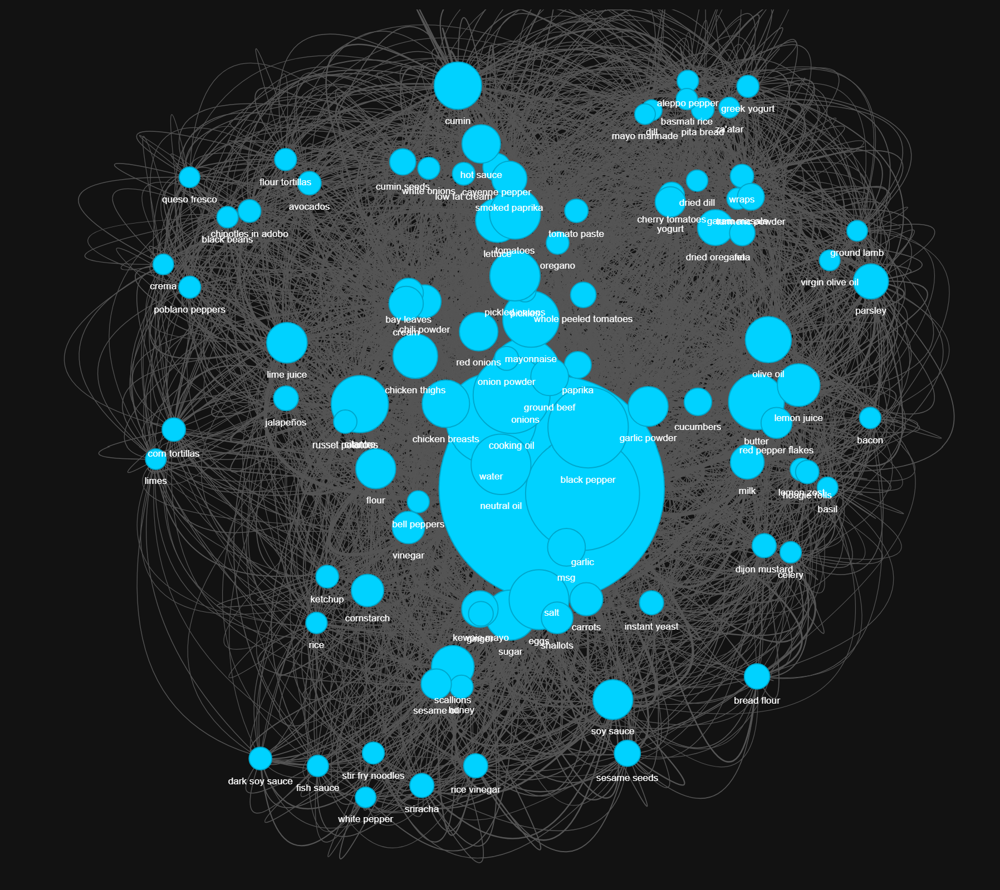
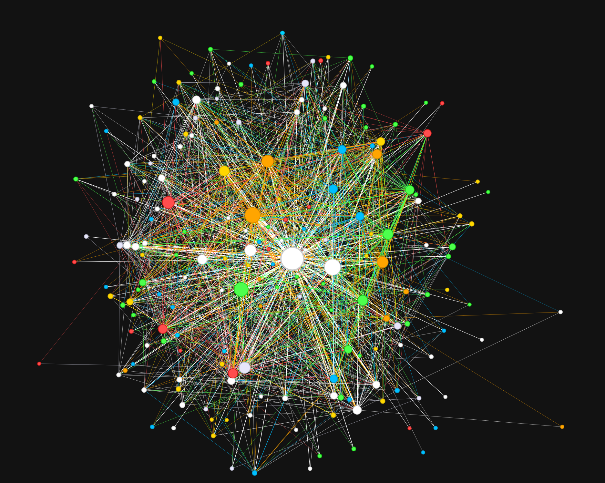

# Culinary Network Analysis: Decoding Recipe Architecture

> **Project Status:** V 1.0 First release  
> **Primary Data Source:** Cookwell.com (Scraped 10/1/2026; site architecture has since changed)

## 📖 Project Overview
Over a weekend, I wanted to create a small visualization tool utilizing web-scraped data to understand what recipe collections look like based on how ingredients are connected. Originally, this was intended as a practice feature for a personal recipe book project, utilizing outside data before my own dataset was complete. 

The project quickly evolved into a full-scale analytical tool. By mapping ingredient co-occurrence into an interactive network graph, it visualizes the "DNA" of recipe design and explores the hidden connections between flavors, proteins, and culinary trends.

## 🧠 The Core Hypothesis
When creating recipes, there exist various philosophies around how dishes should be constructed. By analyzing network topology, this project investigates:
* **The Protein-First Approach:** Do recipes cluster tightly around a central protein node, with vegetables and starches acting as peripheral satellites?
* **The Flavor-First Approach:** Do spices, acids, and aromatics act as the primary "bridges" connecting disparate ingredients across different dishes?
* **The Trend-Driven Approach:** How do viral or seasonal ingredients temporarily alter the network structure, creating isolated, short-lived clusters?

## 🏗️ The Data Pipeline
This project utilizes a modular, three-stage data pipeline to transform raw HTML into an interactive, categorized galaxy.

### Phase 1: Automated Extraction
* **Target:** Cookwell.com XML sitemaps.
* **Methodology:** Navigates sitemaps, implements custom User-Agent headers to bypass basic anti-bot measures, and extracts structured recipe data while actively filtering out UI elements, navigation tags, and instructional text.

### Phase 2: "Gold Standard" Data Cleaning
Raw web data is notoriously messy. This phase utilizes a rigorous, multi-pass cleaning algorithm to ensure 100% data integrity before analysis:
* **Regex & NLP:** Strips invisible Unicode characters, normalizes measurements (e.g., removing stray 'g', 'oz', 'cups'), and resolves algorithmic duplicates caused by mobile vs. desktop HTML rendering.
* **Edge-Case Resolution:** Custom logic to repair data casualties from scraping, such as restoring "low fat" when an aggressive filter accidentally removed the word "fat".
* **Categorization:** Maps 700+ unique ingredients into macro-categories (Protein, Vegetable, Seasoning, Carb, Dairy, Fat/Oil) to enable color-coded network analysis.

### Phase 3: Network Construction & Visualization
* **Nodes:** Represent unique ingredients. Size is determined by frequency (popularity); color is determined by macro-category.
* **Edges:** Represent co-occurrence. An edge is drawn if two ingredients appear in the same recipe. Edge thickness and color are determined by connection strength and the "dominant" ingredient.
* **Physics:** Utilizes a Barnes-Hut force-directed algorithm with custom damping and overlap constraints to create a stable, readable, and aesthetically pleasing constellation.

## 📊 Visualizations & Findings

### The "Hairball" Effect
  
*Initial render showing the "hairball" effect of excessive connections and the gravitational "black hole" pull of universal ingredients like Salt and Water.*

### The Categorized Galaxy
  
*Final render with Salt/Water excluded, nodes colored by macro-category, straight-line edges, and connections colored by the dominant ingredient. This reveals distinct culinary clusters.*

## 🛠️ Tech Stack
* **Languages:** Python 3.x
* **Data Manipulation:** Pandas, Collections (Counter)
* **Web Scraping:** BeautifulSoup4, Requests, Regex
* **Network Analysis:** NetworkX
* **Visualization:** Pyvis (Vis.js)
* **Version Control:** Git / GitHub

## 🔮 Future Expansion & Roadmap
This project is designed to be modular and scalable. Future development is structured into distinct version releases:

### ✅ Version 1.0: The Adjustable Cookwell Database (Current)
- [x] Build end-to-end scraping and cleaning pipeline.
- [x] Implement macro-categorization and color-coded network visualization.
- [x] Optimize physics engine to eliminate the "hairball" effect.
- [x] Implement a JavaScript-driven UI dropdown menu to allow users to dynamically toggle specific ingredient categories on/off, isolating specific "flavor webs" or "protein clusters."

### 🚧 Version 2.0: Author-Centric Analysis (Serious Eats)
- [ ] Expand the scraping pipeline to ingest data from high-end culinary sites (e.g., *Serious Eats*).
- [ ] Extract and map **Author/Chef metadata** to individual recipes.
- [ ] Build comparative network graphs to answer: *"How does Author A's flavor-bridge topology differ from Author B's?"*
- [ ] Track how ingredient networks shift over time (e.g., comparing 2020 vs. 2026 data) to identify and predict macro-culinary trends.

### 🌌 Version 3.0: Cross-Platform & Temporal Analysis
- [ ] Migrate the "Gold Standard" CSVs into a relational SQL database for complex, multi-source querying.
- [ ] Deploy the interactive visualization to a live web server (e.g., GitHub Pages or Streamlit) for public access.
- [ ] Identify signature ingredient pairings unique to specific culinary creators.

## 🚀 How to View project
**🌐 Live Interactive Demo:**  
You can explore the interactive ingredient galaxy directly in your browser right now:  
👉 **[View Live Demo](https://silverdwarb.github.io/Recipe_Database_project/)**
